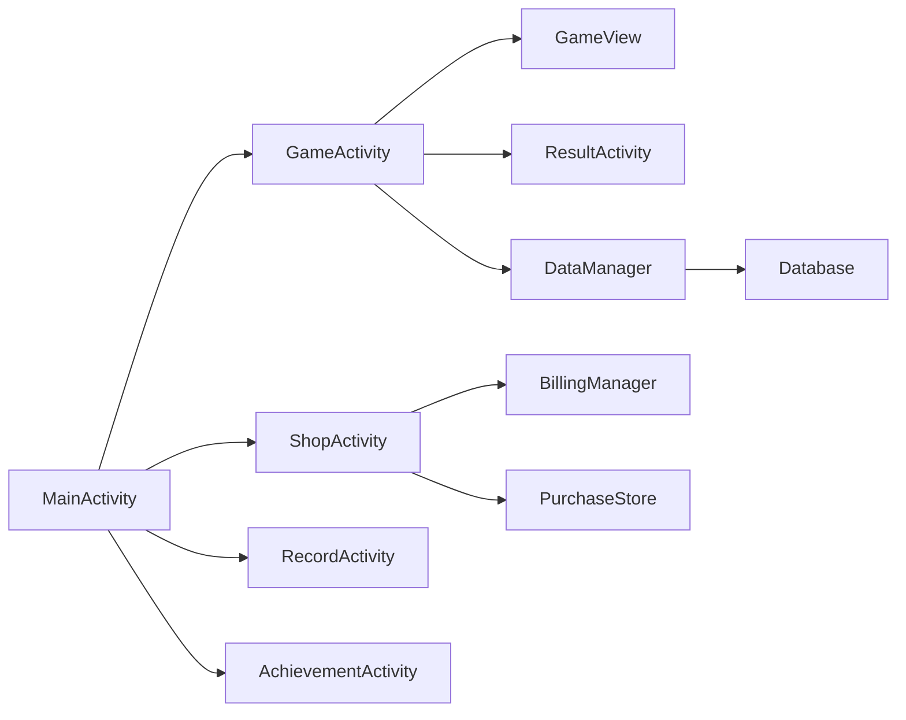

# 내부 구조 안내

## 실행 흐름

`MainActivity`에서 설정, 전투 시작, 상점, 기록, 업적으로 이동한다. `GameActivity`는 전투 화면의 생명주기와 결과 처리를 맡고, `GameView`는 화면 그리기와 터치 조준, 전투 갱신을 수행한다. 종료 결과는 저장 계층에 전달되고 결과·기록 화면에서 표시된다.

## 주요 파일

| 파일 | 역할과 읽을 부분 |
|---|---|
| MainActivity.kt | 메뉴 연결, 설정 대화상자, 언어 선택, 홈 광고 생명주기 |
| GameActivity.kt | 게임 진행 화면, 게임 종료 처리, 전면광고 연결 |
| GameView.kt | 게임 화면 그리기, 터치 입력과 조준, 화살·적의 갱신 및 충돌 |
| Config.kt | 전투에 사용하는 상수와 설정 |
| Models.kt | 전투와 게임 상태를 표현하는 모델 |
| Managers.kt | 저장·생명·세션 관련 관리 객체 |
| ShopActivity.kt / ShopAdapter.kt / ShopBowItem.kt | 상점 목록과 활·아이템 표시 |
| BillingManager.kt | Google Play Billing 연결과 구매 흐름 |
| PurchaseStore.kt | 구매 및 사용자 설정의 로컬 보관 |
| DataManager.kt | 전투 기록과 업적 진행을 다루는 계층 |
| Database.kt | Room 데이터베이스, 엔티티·DAO 구성 |
| RecordActivity.kt | 누적 기록과 통계 화면 |
| AchievementActivity.kt / AchievementAdapter.kt | 업적 목록과 달성 상태 표시 |
| LocaleHelper.kt / BaseActivity.kt | 선택 언어를 Context에 적용하고 유지 |
| SoundManager.kt | 사운드 재생 관리 |
| res/layout | 각 화면과 목록 행의 XML 레이아웃 |
| res/values 및 언어별 values 폴더 | 화면 문자열, 테마 등 리소스 |

## 기술 구성과 검증 범위

Kotlin과 Android XML UI, 커스텀 GameView, Room 2.6.1, Coroutines, Google Play Billing 8.0.0, Mobile Ads 23.6.0을 사용한다. 프로젝트 설정은 minSdk 24, compileSdk/targetSdk 36, Java/Kotlin JVM target 11이다. 이 버전 표는 읽은 프로젝트 설정을 기록한 것이며 최신 버전 추천이 아니다.

공개 ZIP에는 61개의 텍스트 파일이 들어 있다. 파일 경로와 본문을 익명화한 뒤 전후 차이를 계산했으며, 실제 촬영 변경은 두 Activity에만 있다. 이미지·음원과 운영 설정이 제외되어 공개 ZIP 자체의 빌드 테스트는 수행하지 않았다. 게임 전체의 회귀 테스트나 결제 테스트를 완료했다고 주장하지 않는다.
