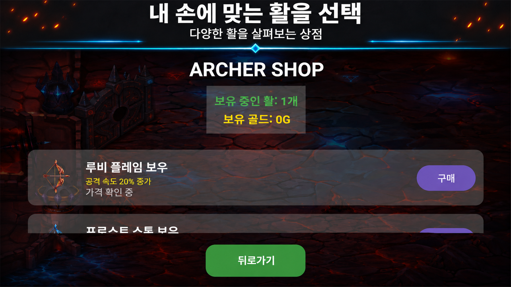
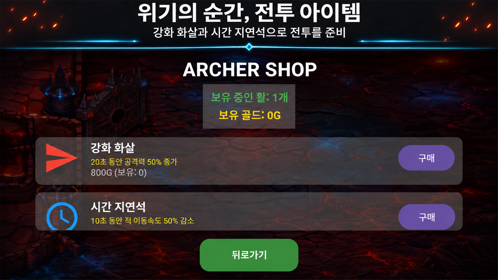
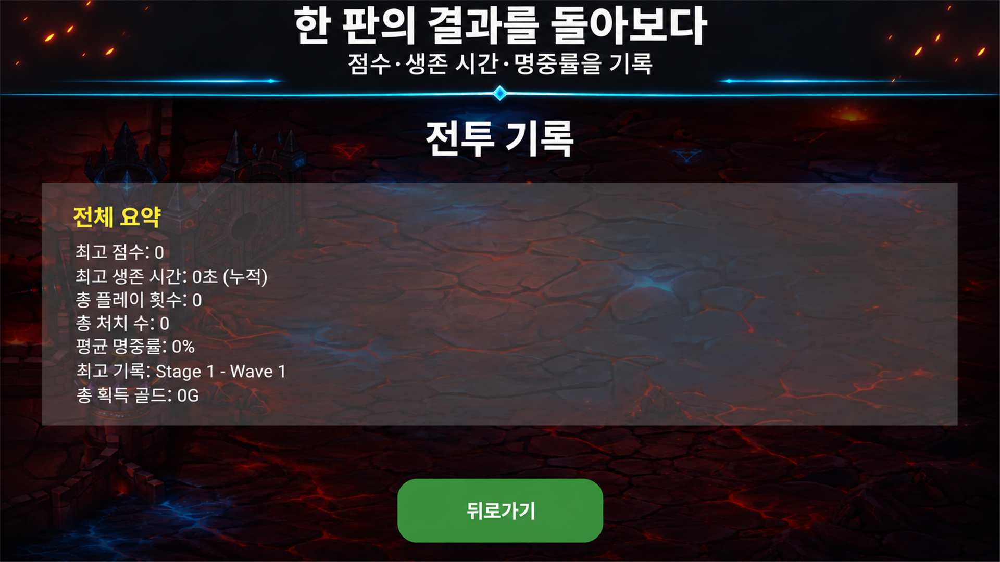

# Bow Defense · 2026-11-27

활로 몬스터의 접근을 막는 Android 생존 디펜스 게임의 스토어 개선 기록과 익명화한 내부 소스 자료입니다. 저장소 이름은 기존 날짜 표기 방식에 맞춘 `bow-defense_261127`이며, 실제 서비스 이름과 운영 식별자는 공개 자료에서 대체했습니다.

이번 작업은 국가 배포 상태 점검, 스토어 설명 정비, 소개 이미지 교체입니다. 배포 중인 게임의 규칙이나 AAB를 변경한 업데이트는 아닙니다. 코드의 전후 차이는 실제 화면을 안전하게 촬영하기 위한 작업용 복사본의 광고 요청 비활성화입니다.

## 결과

| 항목 | 변경 전 | 2026-11-27 결과 |
|---|---|---|
| 국가·지역 | 178개 대상, 미대상 0개 | 가능한 전체 대상임을 확인, 설정 유지 |
| 스토어 언어·지역 | 28개 | 43개, 15개 추가 |
| 소개 문구 | 반복 문단, 언어 혼합 제목, 일부 불완전한 짧은 설명 | 실제 조작·성장·상점·기록·지원 언어 중심으로 정리 |
| 휴대전화 이미지 | 기존 4장 | 전투·활·아이템·업적·기록의 5장 |
| 이미지 규격 | 세로 이미지 등 혼재 | PNG, 1920×1080, 16:9, 장당 8MB 미만 |
| 제출 | 미제출 | 자동 검사 종료 후 Console에서 실제 검토 중 상태 확인 |
| 배포 파일 | 기존 릴리스 | 교체하지 않음 |

판매자 상태 선언은 소유자가 완료했습니다. 그 뒤 스토어 수정 100개와 선언 1개가 검토 흐름에 들어간 상태를 확인했습니다. 심사 승인 또는 실제 스토어 반영 완료를 의미하지는 않습니다. 관리형 게시가 꺼져 있는 상태였습니다.

## 소개 이미지

실행한 게임의 다섯 화면을 참고해 내장 이미지 생성 도구로 제작한 홍보 이미지입니다. 화면의 기능과 수치를 기준으로 구성했으며, 촬영 원본 그대로의 무가공 스크린샷은 아닙니다. 이미지 내 문구와 게임 UI는 한국어이며, 모든 지역에서 공통 기본 이미지로 사용합니다. 43개는 스토어 텍스트의 언어·지역 수입니다.

## 자료 읽는 순서

1. [상세 작업 기록](CHANGELOG-2026-11-27.md): 관찰한 문제, 수정 범위, 검증과 한계.
2. [내부 구조 해설](ARCHITECTURE.md): 실행 화면에서 저장 계층까지 각 파일의 역할.
3. [전후 코드 차이](capture-only-changes.patch): 촬영 전용 변경 두 파일.
4. [변경 전 소스 ZIP](source-before-2026-11-27.zip), [촬영용 변경 후 소스 ZIP](source-after-capture-only-2026-11-27.zip): 각각 텍스트 소스 61개.
5. [익명화한 43개 등록정보](store-listings-43-locales.anonymized.json), [검증 기록](verification.json), [이미지 프롬프트](image-prompts.txt).

핵심 변경 파일은 `MainActivity.before.kt` / `MainActivity.after.kt`, `GameActivity.before.kt` / `GameActivity.after.kt`로 바로 비교할 수 있습니다. `GameView.kt`, `Config.kt`, `LocaleHelper.kt`, `Database.kt`, `DataManager.kt`는 구조를 살펴보기 위한 변경 없는 참고 파일입니다.

## 소스 공개 범위

Kotlin, XML, Gradle 설정과 버전 목록을 포함하고 패키지를 `com.example.bowdefense`로 바꿨습니다. 운영 광고 식별자는 `REDACTED_AD_IDENTIFIER`로 대체했습니다. 서명키, 로컬 경로 설정, 계정 정보, 빌드 산출물, APK/AAB, 바이너리 그림·음원·Gradle wrapper JAR는 포함하지 않습니다. 따라서 ZIP은 코드 열람용이며 그대로 빌드 가능한 배포 프로젝트가 아닙니다. 실제 디버그 빌드 검증은 비공개 작업 복사본에서 수행했습니다.

공개용 명칭 대체는 운영 앱에 적용하지 않았습니다. 별도 오픈소스 라이선스는 부여하지 않았습니다.
